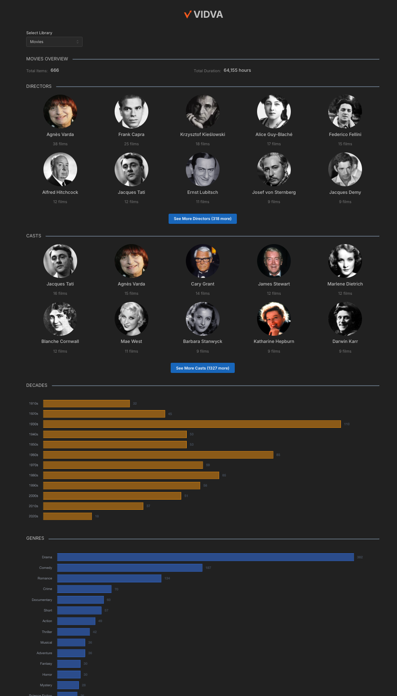

# VIDVA

A Dashboard for displaying interactive statistics about your Plex media library.



## Features

- View library statistics in real-time with interactive charts and visualizations
- Breakdowns for genres, countries, decades, directors, and cast

## Docker

| Registry   | Architecture  | Version | Image Path              |
| ---------- | ------------- | ------- | ----------------------- |
| Docker Hub | AMD64, ARM64  | Latest  | `vanshady/vidva:latest` |

## Docker Instructions

Pass in env:

```bash
- PLEX_SERVER_URL=your_plex_server_url # http://<Your Plex's IP Address>:32400
- PLEX_TOKEN=your_plex_token # https://support.plex.tv/articles/204059436-finding-an-authentication-token-x-plex-token/
- PLEX_SERVER_ID=your_plex_server_id # Go to <PLEX_SERVER_URL>/identity and copy the server ID from machineIdentifier=
- VIDVA_DEFAULT_TOP_CAST_COUNT=4 # all or 3 (plex default) or 4 (letterboxd default) or 5 or 10
```

`PLEX_URL` is accepted as an alias for `PLEX_SERVER_URL`.

Bind port 5173 and voila!

### How VIDVA talks to Plex

The browser never contacts Plex directly. The container proxies `/plex/*` to `PLEX_SERVER_URL` and adds the token on the server side, so:

- The Plex token is never sent to the browser.
- VIDVA works behind an HTTPS reverse proxy even when Plex itself is plain HTTP, and Plex needs no CORS setup. The container must be able to reach `PLEX_SERVER_URL`.
- The proxy only forwards the exact read-only requests the dashboard makes (library lists, item metadata, artwork). Server settings, account data, scans/refreshes and anything that writes get 403, and artwork requests can only point at library thumbnails.

Anyone who can open VIDVA can browse your library through it. If you expose it beyond your LAN, put authentication in front of it (Authelia, Cloudflare Access, your reverse proxy's basic auth, etc.).

## Prerequisites

- Node.js 20.19+ or 22.12+ (required by Vite 8)
- npm
- A running Plex Media Server
- Plex API token

## Getting Started

1. Clone the repository:

```bash
git clone https://github.com/vanshady/vidva.git
cd vidva
```

2. Install dependencies:

```bash
npm install
```

3. Configure your Plex server:

Copy `.env.example` to `.env` and fill it in. The dev server proxies `/plex/*` exactly like the container does, so the URL and token stay unprefixed (Vite only exposes `VITE_` names to browser code):

```bash
PLEX_SERVER_URL=your_plex_server_url
PLEX_TOKEN=your_plex_token
VITE_PLEX_SERVER_ID=your_plex_server_id
VITE_DEFAULT_TOP_CAST_COUNT=4
```

4. Start the development server:

```bash
npm run dev
```

5. Open your browser and navigate to `http://localhost:5173`

## Project Structure

```text
src/
├── components/
│   ├── data/      # HTML/CSS charts, ranked rows, poster grid, loading and error states
│   └── layout/    # app shell, sidebar, search, library picker
├── lib/           # library aggregation, formatting, URL state
├── pages/         # overview, index and detail pages
├── services/      # Plex API client
└── assets/
```

## Technologies Used

- React 19
- Vite
- TypeScript
- Mantine UI
- TanStack Query
- React Router
- Plex API

## License

This project is licensed under the MIT License - see the [LICENSE](LICENSE) file for details.
